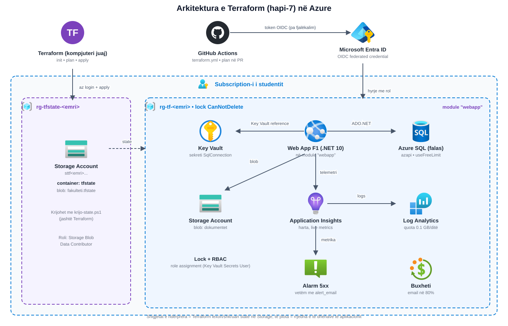

# Mësimi 3 — Infrastructure as Code me Terraform

Në Mësimin 2 i krijuam burimet në Azure **me dorë** (Portal dhe skripta `az`). Sot i krijojmë **me kod**, me **Terraform**,
në **subscription-in tuaj**. Të njëjtën infrastrukturë (Web App, SQL falas, Key Vault, Storage), por të përsëritshme, të ruajtura në Git dhe të fshirshme me një komandë.

> Vetëm burime **falas** ose pothuajse falas. PostgreSQL nuk krijohet.



## Si ta ndiqni (rendi i leximit)

| # | Dokumenti | Çfarë mësoni | Koha |
|---|---|---|---|
| 1 | [Pse Terraform?](docs/01-pse-terraform.md) | Problemet e punës me dorë dhe si i zgjidh IaC | 10 min |
| 2 | [Çfarë është Terraform](docs/02-cfare-eshte-terraform.md) | Konceptet: provider, resource, variabël, output, state, plan/apply | 15 min |
| 3 | [Si organizohet një projekt](docs/03-organizimi.md) | Skedarët, sintaksa HCL, varësitë, strukturat e dosjeve | 10 min |
| 4 | [Parakushtet](docs/04-parakushtet.md) | Instalimi i Terraform, `az login`, regjistrimi i shërbimeve | 20 min |
| 5 | [Hapat 1-5 (lokalisht)](docs/05-hapat-lokalisht.md) | Ndërtojmë infrastrukturën hap pas hapi | 90 min |
| 6 | [State dhe sekretet](docs/06-state-dhe-sekretet.md) | State në Azure Storage, ku fshihen sekretet | 20 min |
| 7 | [GitHub Actions](docs/07-github-actions.md) | `plan` në pull request, `apply` në `main`, me OIDC | 40 min |
| 8 | [Detyrat](docs/08-detyrat.md) | Ushtrime për secilin | në shtëpi |
| 9 | [Pastrimi dhe problemet](docs/09-pastrimi-dhe-probleme.md) | `destroy`, kostot, gabimet e zakonshme | referencë |
| 10 | [Fjalori](docs/10-fjalori.md) | Termat shqip/anglisht | referencë |
| 11 | [Hapi 7: të avancuarit](docs/11-hapi-7-avancuar.md) | Modul, Application Insights, lock/buxhet, `terraform test`, Checkov, plan në PR, drift | 60 min |
| — | [Për profesorin](docs/per-profesorin.md) | Agjenda e orës dhe këshilla | |

## Çfarë do të ndërtojmë

```text
Subscription i juaj
├─ rg-tfstate-<emri>        ← ku ruhet state (krijohet me skriptë, një herë)
└─ rg-tf-<emri>             ← krijohet nga Terraform
     ├─ Storage account + container "dokumentet-<emri>"   (blobs)
     ├─ App Service Plan (F1, falas) + Web App .NET 10    (aplikacioni)
     ├─ Key Vault (RBAC) + sekretet StorageConnection, SqlConnection
     └─ SQL Server + bazë e të dhënave FALAS (free offer)
```

## Struktura e kësaj repo

```text
hapi-1-grupi/      vetëm një Resource Group (fillimi)
hapi-2-variabla/   + variabla, random, Storage
hapi-3-webapp/     + App Service Plan dhe Web App
hapi-4-keyvault/   + Key Vault, role, sekrete
hapi-5-sql/        + SQL Server dhe bazë falas   (infrastruktura e plotë)
hapi-6-state/      hapi-5 + state në Azure (përdoret nga GitHub Actions)
hapi-7-avancuar/   hapi-6 + modul, Application Insights, lock/buxhet, teste
scripts/           krijo-state.ps1, oidc-github.ps1
.github/workflows/ terraform.yml
docs/              udhëzuesit
```

Çdo `hapi-N` është një projekt i plotë që punon vetë. Hapi N+1 është hapi N plus një ndryshim të vogël, ndaj e shihni qartë çfarë shtohet.

## Fillimi i shpejtë (kush nxiton)

```powershell
az login
az account show --query id -o tsv           # subscription_id juaj
cd hapi-5-sql
copy terraform.tfvars.example terraform.tfvars   # plotësoni subscription_id dhe emri
terraform init
terraform plan
terraform apply
```

Kush e bën për herë të parë: filloni nga [dokumenti 4](docs/04-parakushtet.md).
