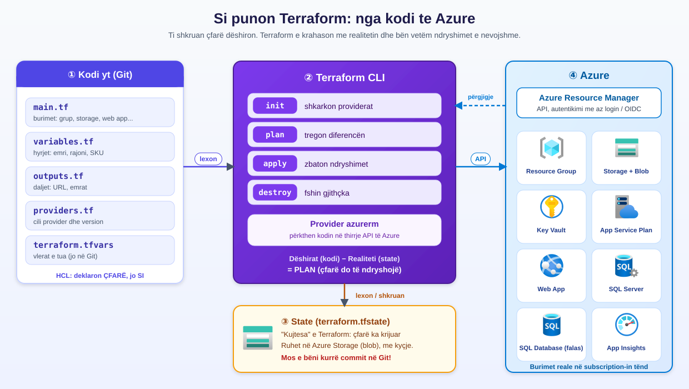

# 2. Çfarë është Terraform

**Terraform** është një program (një skedar `terraform.exe`) që lexon skedarët tuaj `.tf`, krahason atë që dëshironi me atë që ekziston në cloud, dhe bën ndryshimet e nevojshme.

```text
  skedarët .tf  ──►  terraform  ──►  Azure (përmes API)
  (çfarë dua)         │
                      └──► state (çfarë ka krijuar deri tani)
```



1. **Kodi (①)**: ju shkruani skedarët `.tf` dhe i ruani në Git.
2. **Terraform CLI (②)**: `init` shkarkon providerat, `plan` krahason kodin me state dhe tregon diferencën, `apply` e zbaton, `destroy` e fshin.
3. **State (③)**: kujtesa e Terraform; ruhet në Azure Storage.
4. **Azure (④)**: provider-i `azurerm` flet me Azure Resource Manager, i cili krijon burimet.

## Terraform kundrejt PowerShell / Azure CLI

Të dyja krijojnë të njëjtat burime, por mënyra e punës ndryshon rrënjësisht.

| | PowerShell / `az` CLI | Terraform |
|---|---|---|
| Stili | **Imperativ**: i tregoni *hapat* ("krijo këtë, pastaj këtë") | **Deklarativ**: përshkruani *gjendjen e dëshiruar* |
| Ekzekutim i dytë | Gabim "ekziston" ose duplikim; duhet shkruar kontrolle `if` | Pa ndryshime; është **idempotent** |
| Ndryshim i një vetie | Shkruani komandë të re `az ... update` | Ndryshoni vlerën në kod dhe bëni `apply` |
| Para se të ndryshojë | S'ka pamje paraprake (veç `--dry-run` në disa komanda) | `terraform plan` tregon saktë `+ ~ -` |
| Mban mend çfarë krijoi? | Jo; skripta s'di çfarë ekziston | Po, në **state** |
| Varësitë (renditja) | I rendisni vetë | I llogarit vetë (graf, shih dok. 3) |
| Fshirja | Shkruani skriptë të veçantë, burim pas burimi | `terraform destroy` fshin gjithçka që krijoi |
| Drift (dikush ndryshoi në Portal) | I padukshëm | `plan` e zbulon |
| Rishikimi në ekip | Skriptë e vështirë për t'u krahasuar | Kod në Git, `plan` në Pull Request |
| Mësimi | I shpejtë, i mirë për një komandë të vetme | Kërkon konceptet (state, provider) |
| Më i mirë për | Prova të shpejta, automatizime të vogla, demo | Infrastrukturë e përsëritshme dhe e mirëmbajtur |

Shembull: i njëjti grup burimesh.

```powershell
# PowerShell / az: imperativ
if (-not (az group exists -n rg-tf-ardian | ConvertFrom-Json)) {
  az group create -n rg-tf-ardian -l swedencentral
}
az tag update --resource-id ... --operation merge --tags viti=2026
```
```hcl
# Terraform: deklarativ
resource "azurerm_resource_group" "rg" {
  name     = "rg-tf-ardian"
  location = "swedencentral"
  tags     = { viti = "2026" }
}
```
Terraform e krijon nëse mungon, e përditëson nëse ndryshon dhe s'bën asgjë nëse është gati.

> Nuk është "ose/ose". Në Mësimin 2 e mësuam me `az` që të kuptojmë çfarë ndodh; me Terraform e bëjmë të përsëritshme.

Shkruhet në gjuhën **HCL** (HashiCorp Configuration Language): e thjeshtë, si JSON i lexueshëm, me komente `#`.

## Konceptet bazë

### 1. Provider
Plugin që i mëson Terraform-it si të flasë me një shërbim. Terraform vetë nuk di asgjë për Azure; e di `azurerm`.

```hcl
terraform {
  required_providers {
    azurerm = { source = "hashicorp/azurerm", version = "~> 4.0" }
  }
}
provider "azurerm" {
  subscription_id = var.subscription_id
  features {}
}
```
`terraform init` i shkarkon providerat në dosjen `.terraform/`.

### 2. Resource (burim)
Një gjë që Terraform **krijon dhe menaxhon**.

```hcl
resource "azurerm_resource_group" "rg" {   # resource "LLOJI" "EMRI_LOKAL"
  name     = "rg-tf-ardian"
  location = "swedencentral"
}
```
- `azurerm_resource_group` = lloji (nga provider-i)
- `rg` = emri në kod; e referoni me `azurerm_resource_group.rg`
- brenda `{ }` janë vetitë (argumentet)

### 3. Data source
**Lexon** diçka që ekziston tashmë, pa e krijuar.
```hcl
data "azurerm_client_config" "current" {}   # kush jam unë, cili tenant
# përdorim: data.azurerm_client_config.current.tenant_id
```

### 4. Variable (hyrje)
Parametra të konfigurimit, si argumentet e një funksioni. Vlerat vijnë nga `terraform.tfvars`, nga `-var`, ose nga variablat e mjedisit `TF_VAR_emri`.
```hcl
variable "emri" {
  type        = string
  description = "Emri juaj i vogël"
}
# përdorim: var.emri
```

### 5. Local
Vlerë e llogaritur brenda kodit, për të mos e përsëritur.
```hcl
locals { tags = { studenti = var.emri } }
# përdorim: local.tags
```

### 6. Output (dalje)
Çfarë shfaq Terraform në fund (p.sh. URL e aplikacionit).
```hcl
output "app_url" { value = "https://${azurerm_linux_web_app.app.default_hostname}" }
```

### 7. Referencat dhe varësitë
Kur një burim përdor vlerën e tjetrit (`azurerm_resource_group.rg.name`), Terraform kupton **rendin**: krijon grupin para storage-it. Kjo quhet *graf varësish*. Terraform krijon në paralel çka nuk varet nga njëri-tjetri.

Kur varësia nuk shihet në kod, e shkruani vetë me `depends_on = [...]`.

### 8. State (gjendja)
Skedari `terraform.tfstate`: Terraform e ruan aty **çfarë ka krijuar** dhe ID-të e burimeve. Pa të, nuk do dinte që `rg` në kod është ai grup konkret në Azure.

> Rregulla: state **nuk fshihet, nuk ndryshohet me dorë, nuk publikohet në Git** (përmban sekrete). Në ekip ruhet në vend të përbashkët (Azure Storage), shih [dok. 6](06-state-dhe-sekretet.md).

## Cikli i punës (5 komandat)

| Komanda | Çfarë bën | Ndryshon Azure? |
|---|---|---|
| `terraform init` | Shkarkon providerat, përgatit backend-in | Jo |
| `terraform fmt` | Rirenditë kodin në stilin standard | Jo |
| `terraform validate` | Kontrollon sintaksën | Jo |
| `terraform plan` | **Tregon çfarë do të ndryshojë** (+ krijohet, ~ ndryshon, - fshihet) | Jo |
| `terraform apply` | Zbaton planin (kërkon "yes") | **Po** |
| `terraform destroy` | Fshin gjithçka që menaxhon | **Po** |

Si lexohet plan-i:

```text
  + krijohet        ~ ndryshohet në vend       - fshihet       -/+ fshihet e rikrijohet
Plan: 5 to add, 0 to change, 0 to destroy.
```

**Zakoni i artë: gjithmonë lexoni `plan` para `apply`.** Veçanërisht `-` dhe `-/+` (humbje të dhënash!).

## Terraform kundrejt asaj që bëmë me `az`

| `az` (Mësimi 2) | Terraform |
|---|---|
| `az group create -n rg-x -l swedencentral` | `resource "azurerm_resource_group" ...` |
| `az webapp create ...` | `resource "azurerm_linux_web_app" ...` |
| `az keyvault secret set ...` | `resource "azurerm_key_vault_secret" ...` |
| Përsëritja jep gabim | Përsëritja nuk ndryshon asgjë |

Vazhdoni: [3. Si organizohet një projekt](03-organizimi.md)
