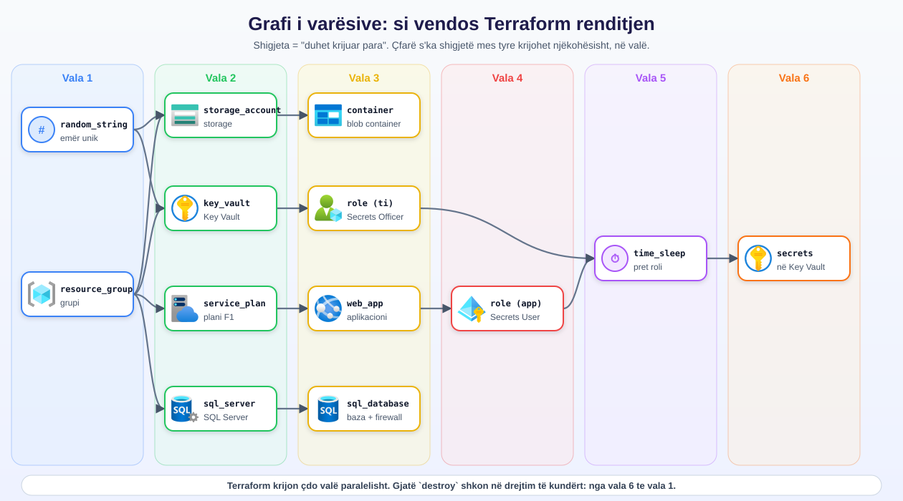

# 3. Si organizohet një projekt Terraform

## Rregulli kryesor

Terraform lexon **të gjithë skedarët `.tf` në një dosje** dhe i trajton si një të vetëm. Emrat e skedarëve janë vetëm për rregull, jo për funksionim. Konventa e zakonshme:

| Skedari | Përmbajtja |
|---|---|
| `providers.tf` (ose `versions.tf`) | Blloku `terraform {}` me versionet dhe `provider` |
| `variables.tf` | Të gjitha `variable` |
| `main.tf` | Burimet kryesore |
| `outputs.tf` | Të gjitha `output` |
| `keyvault.tf`, `sql.tf`, ... | Burimet e ndara sipas temës (kur `main.tf` rritet) |
| `backend.tf` | Ku ruhet state |
| `terraform.tfvars` | Vlerat tuaja (NUK ngarkohet në Git) |
| `terraform.tfvars.example` | Shembull i tij (ngarkohet në Git) |
| `.terraform.lock.hcl` | Versionet e sakta të provider-ave (ngarkohet në Git) |
| `.terraform/` | Provider-at e shkarkuar (nuk ngarkohet) |
| `terraform.tfstate` | State lokal (nuk ngarkohet **kurrë**) |

## Anatomia e një skedari `.tf`

```hcl
# Komentet fillojnë me #

resource "azurerm_storage_account" "st" {      # lloji, emri lokal
  name                = "st${var.emri}"         # string me interpolim: ${...}
  resource_group_name = azurerm_resource_group.rg.name   # referencë te burimi tjetër
  account_tier        = "Standard"              # string
  https_traffic_only_enabled = true             # boolean
  tags                = local.tags              # map (objekt)

  blob_properties {                             # bllok i brendshëm
    versioning_enabled = true
  }
}
```

Llojet e vlerave: `string "tekst"`, `number 5`, `bool true`, `list ["a","b"]`, `map { a = 1 }`.

Emërtimi i burimeve: `<lloji>.<emri_lokal>.<atributi>`
→ `azurerm_storage_account.st.name`, `azurerm_linux_web_app.app.default_hostname`.

## Si e gjej çfarë veti ka një burim?

Dokumentacioni zyrtar: <https://registry.terraform.io/providers/hashicorp/azurerm/latest/docs> — kërkoni p.sh. `azurerm_linux_web_app`.
Çdo faqe ka: shembull, **Arguments** (çfarë shkruani) dhe **Attributes** (çfarë lexoni pas krijimit).

## Cikli i jetës së një burimi në kod

| Ndryshoni në kod | Çfarë ndodh |
|---|---|
| Shtoni një `resource` | Krijohet |
| Ndryshoni një veti (p.sh. `sku_name`) | Përditësohet **në vend** (~) ose **rikrijohet** (-/+), plan-i tregon |
| Fshini `resource` nga kodi | **Fshihet** nga Azure |
| Ndryshoni emrin lokal (`rg` → `grupi`) | Terraform e sheh si fshirje + krijim të ri! |

## Si rritet një projekt

1. **Një dosje, disa skedarë** (ajo që bëjmë në klasë): e mjaftueshme për projekte të vogla.
2. **Module**: dosje me burime të ripërdorshme (p.sh. modul `webapp` që e thërrisni 6 herë, një për student). Mësohet më vonë.
3. **Mjedise**: `dev/`, `prod/` me variabla të ndryshme, e njëjta infrastrukturë.

```text
projekt/
├─ main.tf
├─ variables.tf
├─ outputs.tf
├─ providers.tf
└─ modules/
   └─ webapp/        ← modul i ripërdorshëm
      ├─ main.tf
      ├─ variables.tf
      └─ outputs.tf
```

## Si e ndërton Terraform grafin (shembulli ynë)



Shigjeta = "duhet krijuar para". Çka s'ka shigjetë mes tyre krijohet **njëkohësisht** (brenda një vale). Gjatë `destroy` renditja është e kundërt.

Vazhdoni: [4. Parakushtet](04-parakushtet.md)
